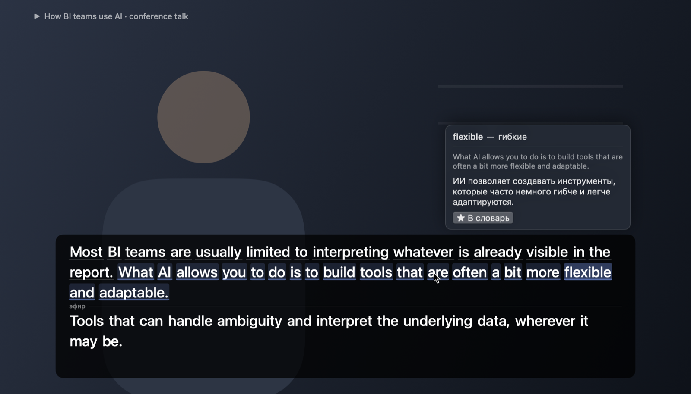
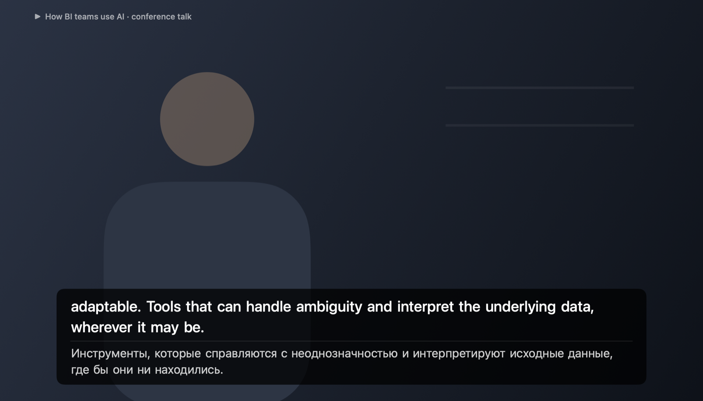
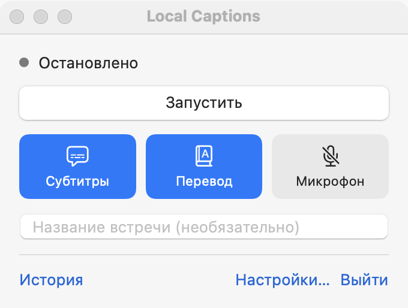
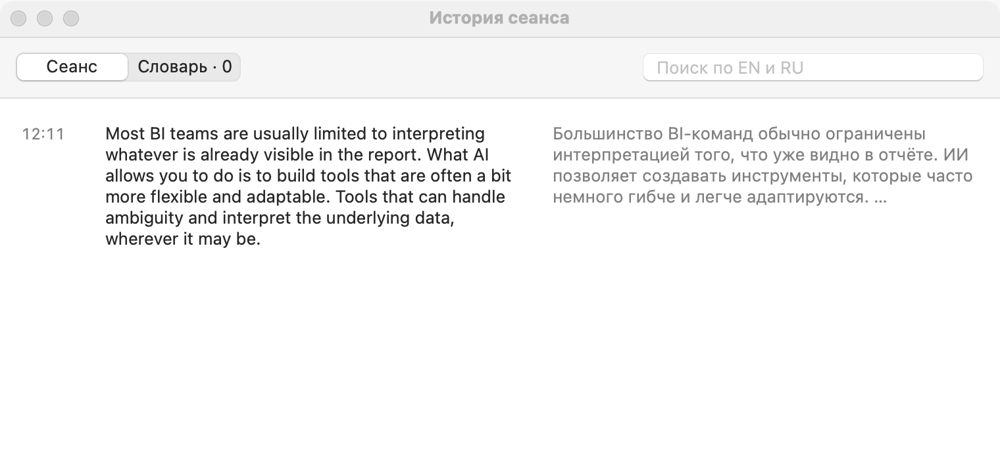
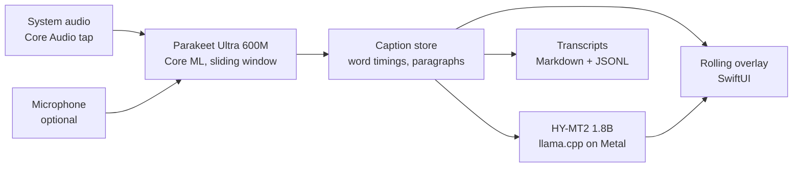

# Local Captions

**Private, offline live captions for anything you hear on a Mac — with a click-to-translate learning mode.**

Series, YouTube, conference talks, work calls: Local Captions listens to system audio from any app,
transcribes English and Russian on device, and lets you look up any word or phrase without pausing
the video. Meetings are saved as plain-text transcripts. Nothing leaves your Mac.

[](#install)
[](#install)
[](#privacy)
[](LICENSE)

[Документация на русском →](README.ru.md)

<p align="center">
  
</p>

## Why

- **Any app, one overlay.** Built-in captions live inside Zoom, Meet or Chrome. Local Captions
  works on the system audio, so the same captions follow you from a series to a call.
- **Learn by listening.** English stays on screen; translation is there only when you ask for it.
  Hover to hold the lines you are reading while speech continues below, click a word you missed.
- **Private by design.** Recognition and translation run locally on Core ML and Metal. No account,
  no cloud, no audio written to disk.

## Features

| | |
|---|---|
| **Rolling captions** | A fixed number of lines; new text appears at the bottom, words arrive one by one, the unsettled tail of a hypothesis is dimmed and a corrected word briefly highlighted. A new paragraph starts after a finished sentence and a pause. |
| **Learning mode** | Hover the captions: the lines you are reading hold still and a curtain unrolls with live speech below. Click a word for its translation in context, double-click for the whole phrase. Phrases with a ready translation are underlined. Save words to a vocabulary. |
| **English ↔ Russian** | Both languages are transcribed in one mode; each phrase is translated into the other language on click. A personal glossary (`витрина = data mart`) fixes terms the model gets wrong. |
| **Translation lane** | An alternative view: English on top, Russian translation in its own lane below that never pushes the English text. |
| **Meeting transcripts** | Every session is saved as Markdown and JSONL with timestamps and the playing app or browser tab. An optional microphone channel adds your own voice to the file only. |
| **Switches that work mid-session** | Hide the subtitles but keep recording, turn translation off to save resources, toggle the microphone for a call. |
| **Measured, not guessed** | Each session appends display latency (p50/p95 from the end of a spoken word to its final spelling on screen), revision rate and translation latency to a local metrics log. |

<table>
  <tr>
    <td width="50%"></td>
    <td width="50%"></td>
  </tr>
  <tr>
    <td align="center">Learning mode: held lines, live curtain, word card</td>
    <td align="center">Translation lane</td>
  </tr>
  <tr>
    <td align="center"></td>
    <td></td>
  </tr>
  <tr>
    <td align="center">Main window</td>
    <td align="center">Searchable session history</td>
  </tr>
</table>

The interface is in Russian for now.

## How it works



- **Capture:** the public Core Audio taps API (`CATapDescription`, macOS 14.4+) with a private tap.
  Only the "system audio recording" permission is needed, not screen recording.
- **Recognition:** [Parakeet Ultra](https://huggingface.co/FluidInference/parakeet-ultra-coreml) through
  [FluidAudio](https://github.com/FluidInference/FluidAudio), streamed in windows of 0.64–2 s with
  6 s of left context. The window is a setting: shorter is faster, longer is more accurate for Russian.
- **Translation:** [HY-MT2 1.8B](https://huggingface.co/tencent/Hy-MT2-1.8B-GGUF) served by
  [llama.cpp](https://github.com/ggml-org/llama.cpp) over a private Unix socket. A clicked word is tagged
  inside its phrase and translated in context.
- **Models are swappable:** recognizers and translators are chosen in settings; adding one for
  comparison is a new enum case plus its loader.

## Measured latency

From the end of a spoken word to its text on screen, real-time playback through the app pipeline
(synthetic voices, Apple M2 Pro). Details and raw data: [docs/window-2026-11-17.md](docs/window-2026-11-17.md).

| Ultra window | English, first appearance p50 / p95 | English word errors | Russian word errors |
|---|---:|---:|---:|
| 1.28 s | 0.72 / 1.30 s | 0% | 5.1–10.1% |
| 0.96 s *(learning default)* | 0.41–0.50 / 0.86–0.98 s | 0–1.6% | 6.3–10.1% |
| 0.64 s *(translation lane default)* | 0.32 / 0.67 s | 0–1.6% | 12.7–15.2% |

A real 6-minute session with the microphone on measured 0.73 s p50 / 0.98 s p95 to the final spelling
on screen, with 2.6% of shown words later corrected.

## Install

Requirements: macOS 15+, Apple Silicon, Xcode with Swift 6.2+, [uv](https://docs.astral.sh/uv/),
about 2.5 GB of disk for models.

```sh
git clone https://github.com/astigo/local-captions.git
cd local-captions
python3 scripts/setup.py
open "dist/Local Captions.app"
```

`setup.py` creates `.runtime/` next to the project: a Python environment for the translator, a pinned
FluidAudio revision, Parakeet Ultra and HY-MT2 with llama.cpp, all checked against SHA-256 hashes,
then builds the app. After that nothing is downloaded. To rebuild without downloading:
`python3 scripts/build.py`.

On first start macOS asks for **System Audio Recording Only**. The build is signed ad hoc, so after
a rebuild macOS may ask again; remove the old entry in Privacy settings and add the new app.

## Use

1. Start the app: the main window opens (also from the captions icon in the menu bar).
2. Press **Запустить** (Start) and play anything with sound.
3. Hover the captions to hold them, click a word to translate it, double-click for the phrase.
4. **История** (History) opens a searchable window; transcripts are in `Transcripts/`.

Settings cover placement (bottom or a right-hand column), lines, font, backdrop opacity, the Ultra
window, word-by-word reveal, browser-tab detection and a per-session statistics table.

## Privacy

- Audio is processed in memory and never saved; only text goes to `Transcripts/`.
- No network access at runtime; models are downloaded once by the setup script.
- The translator listens on a Unix socket readable only by the current user, no TCP port.
- Detecting the playing browser tab is off by default and needs the Accessibility permission.
- `Transcripts/` (meetings, metrics, vocabulary, glossary) is git-ignored.

## Limitations

- Apple Silicon and macOS 15+ only; the build is signed ad hoc.
- English and Russian are the tuned pair; other languages Parakeet Ultra knows are untested.
- Latency figures come from synthetic voices and one real session, not a broad benchmark.
- The UI is in Russian.

## License

Code: [MIT](LICENSE). Models are not part of the repository and keep their own licenses:
Parakeet Ultra — CC BY 4.0, HY-MT2 — Apache 2.0, FluidAudio — Apache 2.0, llama.cpp — MIT.
